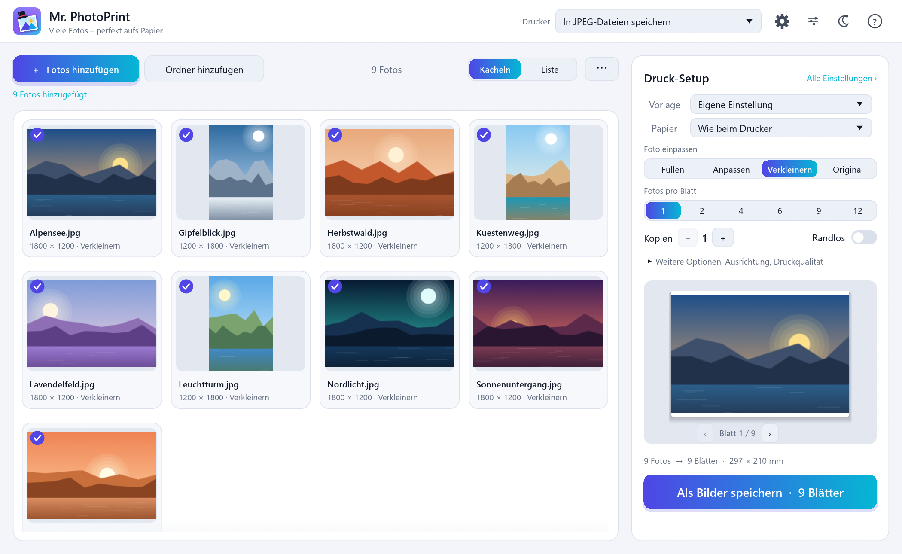
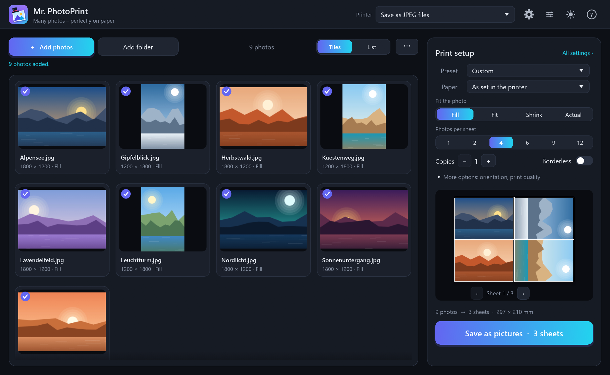

<div align="center">


# Mr. PhotoPrint

**Einen ganzen Stapel Fotos in einem Rutsch drucken – jedes perfekt aufs Papier eingepasst.**

[](https://github.com/MrMarkus42/mr-photoprint/actions/workflows/ci.yml)
[](https://github.com/MrMarkus42/mr-photoprint/releases/latest)

[](#lizenz)


[English](README.md) · Deutsch



</div>

## Wozu?

40 Urlaubsfotos als 10×15-Abzüge sollten nicht 40 Mal den Druckdialog bedeuten. Fotos in
Mr. PhotoPrint ziehen, **„10×15 randlos“** wählen, Vorschau ansehen, **Drucken** – fertig. Jedes
Foto wird automatisch gedreht, skaliert und passend zugeschnitten.

## Funktionen

|  |  |
|---|---|
| 🖼️ **Stapeldruck** | Fotos oder ganze Ordner (mit Unterordnern) hineinziehen und alle auf einmal drucken. |
| 📐 **Passt immer** | *Füllen* (randlos zuschneiden), *Anpassen* (ganzes Foto), *Verkleinern*, *Original* oder *Zoom* – Fotos werden automatisch passend zum Papier gedreht. |
| ⚡ **Vorlagen** | 10×15 und 13×18 randlos, A4 ganzes Foto, 4 auf A4, Kontaktbogen – ein Klick. |
| 🌄 **Wirklich randlos** | Schaltet den Druckertreiber automatisch in den Randlos-Modus (Epson-Randloseinzug, Canon/HP-Randlosformate), mit 1 mm Überstand. |
| 🧻 **Papierart** | Fotopapier direkt aus der Liste des Treibers wählen – erst damit drucken Fotodrucker langsam und fein. |
| 🧩 **Mehrere pro Blatt** | 2, 4, 6, 9, 12 oder ein beliebiges Raster, mit Abstand, Rahmen und Schnittmarken. |
| 👀 **Live-Vorschau** | Jedes Blatt vor dem Druck sehen; Bildausschnitt mit der Maus verschieben. |
| 🔍 **Schärfe-Check** | Warnt, wenn ein Foto mit weniger als 150 dpi gedruckt würde. |
| 🎛️ **Einstellungen pro Foto** | Einzelne Fotos bekommen eigenes Papier, eigene Drehung, Kopien … |
| 💾 **Als JPEG speichern** | Blätter als Bilddateien statt auf Papier – ideal für Fotodienste. |
| 📷 **Viele Formate** | JPEG, PNG, TIFF, WebP, BMP, GIF u. v. m. – dazu HEIC (iPhone), AVIF, JPEG XL und Kamera-RAW über Windows. |
| 🛡️ **Sicher mit jeder Datei** | Manipulierte oder kaputte Dateien bringen es nicht zum Absturz: Formaterkennung am Inhalt, Größengrenzen, abgeschottete Decoder. |
| 🔄 **Signierte Updates** | Optionale automatische Updates, kryptografisch signiert und geprüft. |
| 🌍 **Deutsch & Englisch** | Dunkles und helles Design, eingebaute Hilfe (F1). |
| 🔒 **Privat** | Kein Konto, keine Werbung, keine Telemetrie. |

## Download

1. **`MrPhotoPrint-Setup-x.y.z.exe`** von der
   **[neuesten Version](https://github.com/MrMarkus42/mr-photoprint/releases/latest)** laden.
2. Starten und **„Nur für mich installieren“** (ohne Administratorrechte) oder
   „Für alle Benutzer“ wählen.

Lieber ohne Installation? **`MrPhotoPrint-x.y.z-portable.zip`** entpacken und `MrPhotoPrint.exe`
doppelklicken.

> [!NOTE]
> **„Der Computer wurde durch Windows geschützt“?** Das Programm hat (noch) kein kostenpflichtiges
> Herausgeber-Zertifikat, deshalb warnt SmartScreen beim ersten Start. Auf **Weitere
> Informationen → Trotzdem ausführen** klicken. Jede Version hat Prüfsummen, eine
> [minisign](https://jedisct1.github.io/minisign/)-Signatur und einen GitHub-Herkunftsnachweis –
> siehe [Downloads prüfen](SECURITY.md#downloads-prüfen).

**Voraussetzungen:** Windows 10 oder 11 (64 Bit). Für HEIC-Fotos die kostenlosen
*HEIF-Bilderweiterungen* und *HEVC-Videoerweiterungen* aus dem Microsoft Store installieren.

## So geht's

1. **Fotos hinzufügen** – ins Fenster ziehen.
2. **Drucker und Vorlage wählen** – z. B. *10×15 randlos* oder *4 auf A4*.
3. **Vorschau prüfen** – Ausschnitt mit der Maus anpassen.
4. **Drucken.**

📖 Die **[Anleitung](docs/ANLEITUNG.md)** erklärt alles, inklusive häufiger Fragen.
Im Programm hilft **F1**.

<details>
<summary><b>Screenshot auf Englisch, dunkles Design, 4 Fotos pro Blatt</b></summary>
<br>

</details>

## Updates – sicher gebaut

Mr. PhotoPrint fragt einmal, ob es nach neuen Versionen suchen darf. Sie bestimmen, wie oft und
ob es nur Bescheid sagt, die Installation anbietet oder beim Beenden installiert.

* Jeder Installer ist mit einem Schlüssel signiert, der **den PC des Entwicklers nie verlässt** –
  nicht einmal GitHub hat ihn. Das Programm kennt nur den öffentlichen Schlüssel und lehnt alles
  andere ab.
* Die Signatur nennt die genaue Version – ein alter Installer kann nicht als neuer ausgegeben werden.
* Der Installer ist von der letzten Prüfung bis zum Start durch Windows gegen Änderungen gesperrt.
* Es werden keine Daten über Sie, Ihren PC oder Ihre Fotos gesendet.

Details: [SECURITY.md](SECURITY.md).

## Selbst bauen

```powershell
git clone https://github.com/MrMarkus42/mr-photoprint
cd mr-photoprint
cargo run --release
```

Benötigt Windows und eine aktuelle [Rust](https://rustup.rs)-Version. Mehr in
[CONTRIBUTING.md](CONTRIBUTING.md); wie Fotos platziert werden, steht in
[docs/LAYOUT.md](docs/LAYOUT.md).

## Mitmachen

Fehlermeldungen, Ideen und Pull Requests sind willkommen – auf Deutsch oder Englisch.
[Fehler melden](https://github.com/MrMarkus42/mr-photoprint/issues/new?template=bug_report.yml) ·
[Wunsch äußern](https://github.com/MrMarkus42/mr-photoprint/issues/new?template=feature_request.yml) ·
[Änderungen](CHANGELOG.md)

## Lizenz

Nach Wahl unter der [MIT-Lizenz](LICENSE-MIT) oder der
[Apache-Lizenz 2.0](LICENSE-APACHE). Die Lizenzen der verwendeten Bausteine stehen in
`THIRD_PARTY_LICENSES.html`, die jeder Version beiliegt.
