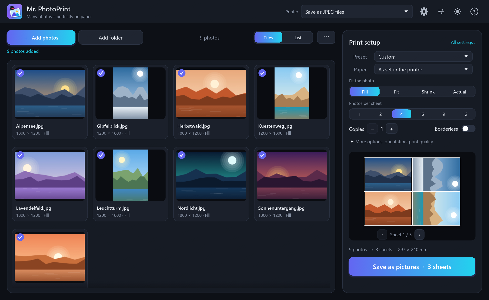
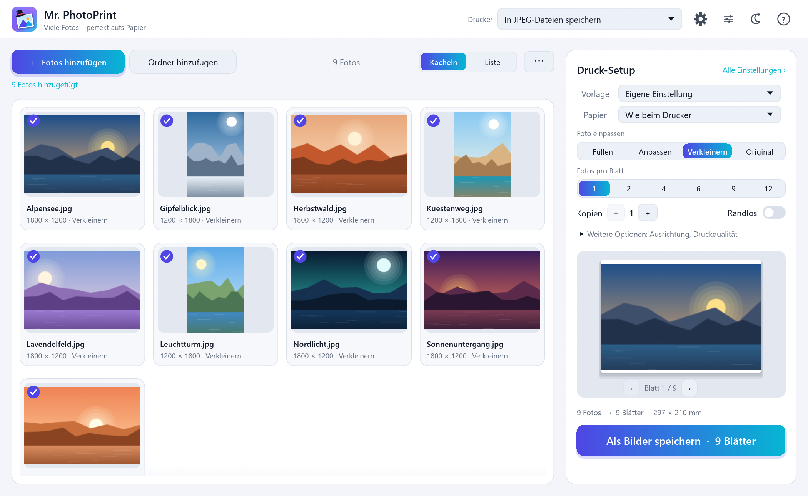

<div align="center">


# Mr. PhotoPrint

**Print a whole stack of photos in one go – each one fitted perfectly to the paper.**

[](https://github.com/MrMarkus42/mr-photoprint/actions/workflows/ci.yml)
[](https://github.com/MrMarkus42/mr-photoprint/releases/latest)

[](#license)


English · [Deutsch](README.de.md)



</div>

## Why?

Printing 40 holiday photos as 10×15 prints shouldn't mean 40 trips through the print dialog.
Drop them into Mr. PhotoPrint, pick **"10×15 borderless"**, check the preview, press **Print** –
done. Every photo is turned, scaled and cropped to the paper automatically.

## Features

|  |  |
|---|---|
| 🖼️ **Batch printing** | Drag in photos or whole folders (with subfolders) and print them all at once. |
| 📐 **Perfect fit** | *Fill* (borderless crop), *Fit* (whole photo), *Shrink*, *Actual size* or *Zoom* – photos are turned to match the paper automatically. |
| ⚡ **Presets** | 10×15 and 13×18 borderless, A4 whole photo, 4 on A4, contact sheet – one click. |
| 🌄 **True borderless** | Switches your printer's driver into borderless mode automatically (Epson borderless feed, Canon/HP borderless sizes), with 1 mm bleed. |
| 🧻 **Paper type** | Pick your photo paper straight from the driver's list – that's what makes photo printers print slow and fine. |
| 🧩 **Several per sheet** | 2, 4, 6, 9, 12 or any grid, with gaps, frames and cut marks. |
| 👀 **Live preview** | See every sheet before printing; drag a photo to move its crop. |
| 🔍 **Sharpness check** | Warns when a photo would print below 150 dpi. |
| 🎛️ **Per-photo settings** | Give single photos their own paper, rotation, copies … |
| 💾 **Save as JPEG** | Render sheets to image files instead of paper – great for photo services. |
| 📷 **Many formats** | JPEG, PNG, TIFF, WebP, BMP, GIF and more – plus HEIC (iPhone), AVIF, JPEG XL and camera RAW via Windows. |
| 🛡️ **Safe with any file** | Hostile or broken files can't crash it: content-based format detection, size limits, sandboxed decoders. |
| 🔄 **Signed updates** | Optional automatic updates, cryptographically signed and verified. |
| 🌍 **German & English** | Dark and light theme, built-in help (F1). |
| 🔒 **Private** | No account, no ads, no telemetry. |

## Download

1. Get **`MrPhotoPrint-Setup-x.y.z.exe`** from the
   **[latest release](https://github.com/MrMarkus42/mr-photoprint/releases/latest)**.
2. Run it and choose **"Install for me only"** (no administrator rights needed) or
   "for all users".

Prefer no installation? Take **`MrPhotoPrint-x.y.z-portable.zip`**, unzip, double-click
`MrPhotoPrint.exe`.

> [!NOTE]
> **"Windows protected your PC"?** The program isn't signed with a paid publisher certificate
> (yet), so SmartScreen may warn on first start. Click **More info → Run anyway**. Every release
> comes with checksums, a [minisign](https://jedisct1.github.io/minisign/) signature and a GitHub
> build attestation – see [how to verify a download](SECURITY.md#verifying-downloads).

**Requirements:** Windows 10 or 11 (64-bit). For HEIC photos install the free *HEIF Image
Extensions* and *HEVC Video Extensions* from the Microsoft Store.

## How it works

1. **Add photos** – drag them into the window.
2. **Choose printer and preset** – e.g. *10×15 borderless* or *4 on A4*.
3. **Check the preview** – drag to adjust a crop.
4. **Print.**

📖 The **[user guide](docs/USER-GUIDE.md)** explains everything, including the FAQ.
Inside the program press **F1**.

<details>
<summary><b>Screenshot in German, light theme</b></summary>
<br>

</details>

## Updates – safe by design

Mr. PhotoPrint asks once whether it may look for new versions. You decide how often and whether
it just tells you, offers to install, or installs when you close it.

* Every installer is signed with a key that **never leaves the maintainer's PC** – not even
  GitHub has it. The program carries only the public key and refuses anything else.
* The signature names the exact version, so an old installer can't be passed off as new.
* The installer is locked from the final check until Windows starts it.
* Nothing about you, your PC or your photos is ever sent.

Details: [SECURITY.md](SECURITY.md).

## Building from source

```powershell
git clone https://github.com/MrMarkus42/mr-photoprint
cd mr-photoprint
cargo run --release
```

You need Windows and a current stable [Rust](https://rustup.rs) toolchain. More in
[CONTRIBUTING.md](CONTRIBUTING.md); how photos are placed is described in
[docs/LAYOUT.md](docs/LAYOUT.md).

Built with [egui](https://github.com/emilk/egui), [wgpu](https://wgpu.rs),
[image](https://github.com/image-rs/image) and [windows-rs](https://github.com/microsoft/windows-rs).

## Contributing

Bug reports, ideas and pull requests are welcome – in English or German.
[Report a bug](https://github.com/MrMarkus42/mr-photoprint/issues/new?template=bug_report.yml) ·
[Suggest a feature](https://github.com/MrMarkus42/mr-photoprint/issues/new?template=feature_request.yml) ·
[Contributing guide](CONTRIBUTING.md) · [Changelog](CHANGELOG.md)

## License

Licensed under either of

* [MIT license](LICENSE-MIT)
* [Apache License, Version 2.0](LICENSE-APACHE)

at your option. The licences of the components used are listed in `THIRD_PARTY_LICENSES.html`,
which comes with every release.
